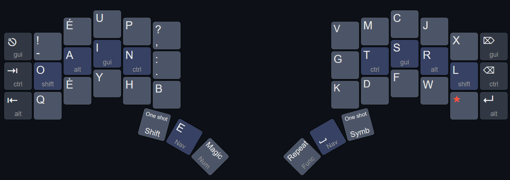
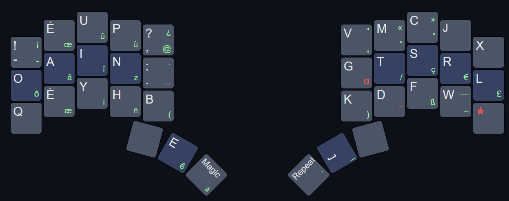

# QMK Krypton keymap for Propergol

&nbsp;</br>
<p align="center">

</p>

&nbsp;</br>
## Philosophy

[Propergol](https://github.com/Kawamashi/Propergol) is a great layout, but it needs 4 dedicated thumb keys (for `Space`, `E`, `Repeat` and `Alt-Repeat`). [Nordrassil](https://github.com/empressabyss/nordrassil/tree/main) needs 4 as well, [Magic Roll](https://github.com/Brooklyn-Style/Magic_Roll) 3. Cramming such layouts into a 36-keys keyboard can be quite a challenge. Krypton is my take on this issue. 

I don’t pretend Krypton is perfect, only you can imagine the layout that suits you the best! I designed Krypton as a solid starting point for those who want to try Propergol without spending hours figuring out the keyboard configuration to use with it. I’ve done my best to make it easy for you to customize Krypton and tailor it to your specific needs.

*Tweak it until you love it!*

* [Layers](#Layers)
    * [Base layer](#Base-layer)
    * [1DK layer](#1DK-layer)
    * [Navigation layer](#Navigation-layer)
    * [Numbers layer](#Numbers-layer)
    * [Symbols layer](#Symbols-layer)
    * [Fonction keys layer](#Fonction-keys-layer)
    * [Windows Management layer](#Windows-Management-layer)
* [Tap-Hold keys configuration](#Tap-Hold-keys-configuration)
    * [Mod-tap keys](#Mod-tap-keys)
    * [Layer-tap keys](#Layer-tap-keys)
* [Features](#Features)
    * [One Shot on Steroids keys](#One-Shot-on-Steroids-keys)
    * [Combos](#Combos)
    * [Layer words](#Layer-words)

&nbsp;</br>
## Layers

### Base layer



- Secondary layers (for navigation, number and function keys) are activated with [Layer Tap](https://docs.qmk.fm/feature_layers) keys under the thumbs.
- Krypton’s default configuration uses [Home-Row Modifiers](https://precondition.github.io/home-row-mods#what-are-home-row-mods) ([HRM](#Modifier-keys)) to make typing shortcuts more comfortable. Users of 6-column keyboards can disable them by commenting out `#define KRYPTON_ENABLE_HRM` in `config_propergol.h`.
- MacOS users can adapt the configuration by commenting out `#define KRYPTON_MAC_MODIFIERS` in `config_propergol.h`.
- To improve typing experience, Krypton uses a [One Shot](https://docs.qmk.fm/one_shot_keys) Shift key. This key should be used to capitalize letters, while [Shift on the home-row](https://precondition.github.io/home-row-mods#shift-thumb-keys) should be used only for shortcuts. 
- Similarly, the Symbols Layer is activated with a One Shot layer key. It’s possible to swap the Symbols, Functions and Numbers keys if you prefer to use a one shot key for numbers. To do so, uncomment `#define KRYPTON_NUMBER_ROW_WITH_ONESHOT` in `config_propergol.h`.
- Easy access to `Backspace`, `Enter`, `Tab`, `Escape`, `Alt-Tab` and `PANIC`, with [combos](#Combos). Even though they are not pictured in the next illustrations, they can be triggered from all layers, providing an easy access to editing keys.

  
<details>
<summary>One shot for Numbers layer</summary>

</details>

&nbsp;</br>
### 1DK layer



Instead of relying solely on Propergol’s driver, the [dead key](https://github.com/Kawamashi/Propergol/blob/main/README.md#la-touche-morte-de-propergol) is implemented as a layer, activated with a [One Shot on Steroids](https://github.com/Kawamashi/qmk_modules/tree/main/oneshots_on_steroids) key. This makes the 1DK system much more flexible:
- You can customize the 1DK layer without having to modify the driver itself.
- If you tapped `★` by mistake, just tap it again to cancel it.
- Holding `★` allows you to chain several characters from the 1DK layer.
- `Repeat` can repeat a character from the 1DK layer.
- The 1DK layer can be made compatible with other QMK features such as [Caps Word](https://docs.qmk.fm/features/caps_word) and Clever Keys.
- If desired, Shift can be applied to the character following the dead key. For example, `Shift` `★` `O` can be used to type `Ô`. To do so,  uncomment `#define ONE_DEAD_KEY_DEFFERED_SHIFT` in `config_propergol.h`.

&nbsp;</br>
### Navigation layer


This layer is activated by holding either thumb home key, on the base layer as well as on Numbers and Symbols layers.

The left half provides:
- Navigation keys (arrows, `Home`/`End`, `Page Up`/`Page Down`)
- Common keyboard shortcuts (`Cut`, `Copy`, `Paste`, `Undo`, `Redo` and `Select All`), allowing you to keep your right hand on the mouse.

The right half provides:
- Editing keys (`Backspace` under the right thumb and index finger home positions, `Delete`, `Enter`, `Escape`, `Tab` and `Shift-Tab`)
- Word-by-word navigation and deletion macros, as well as shortcuts for [selecting words and lines](https://github.com/Kawamashi/qmk_krypton_keymaps/tree/main#word-selection)
- [`Caps Word`](https://docs.qmk.fm/features/caps_word), [`Caps List`](https://github.com/Kawamashi/qmk_krypton_keymaps/tree/main#caps-list) and `Caps Lock`
- `Nav Word`, to type sequences of navigation keys without having to keep the layer-tap key held down. This key triggers a [Layer Word](https://github.com/Kawamashi/qmk_modules/tree/main/layer_word) that remains active as long as you type navigation keys.
- A one shot Windows Management key, to activate the [Windows Management layer](#Windows-Management-layer) using [Lobre’s Shaka Gesture](https://github.com/Kawamashi/qmk_modules/tree/main/oneshots_on_steroids#split-trigger-and-hold-keys)

&nbsp;</br>
### Numbers layer

Krypton’s default configuration uses a a numpad-style Numbers layer:

<details open>
<summary>Numpad</summary>

</details>

In addition to the number keys, the layer provides:
- `★`, to type alternate symbols, like fractions and arithmetic operators (`½`, `⅓`, `×`, `÷`, `±`, etc.)
- `Num Word`, to type sequences of numbers without having to keep the layer-tap key held down. This key triggers a [Layer Word](https://github.com/Kawamashi/qmk_modules/tree/main/layer_word) that remains active as long as you type numeric symbols.
- `Previous`/`Next Window` keys (equivalent to `Alt`+`Tab` or `⌘`+`Tab`) on left hand, allowing you to switch between windows without pressing `Alt` or `⌘`. This functionality is implemented with [Cyclotab](https://getreuer.info/posts/keyboards/cyclotab/).
- A one shot `Win Num` key, to type easily `GUI`+ numbers, using [Lobre’s Shaka Gesture](https://github.com/Kawamashi/qmk_modules/tree/main/oneshots_on_steroids#split-trigger-and-hold-keys)
- A `Toggle Num` key to switch between number-row and numpad keycodes (some applications require one or the other)

&nbsp;</br>
You can also use a number-row layout instead of the default numpad layout:

<details open>
<summary>Numrow</summary>


To enable it, uncomment `#define KRYPTON_NUMBER_ROW` in `config_propergol.h`.
</details>

&nbsp;</br>
Finally, the Symbols and Numbers keys can be swapped if you prefer to activate the Numbers layer with a one shot key:

<details>
<summary>Numrow + one shot key </summary>


To enable it, uncomment `#define KRYPTON_NUMBER_ROW_WITH_ONESHOT` in `config_propergol.h`.
</details>

&nbsp;</br>
### Symbols layer


Krypton uses [Propergol’s Symbols layer](https://github.com/Kawamashi/Propergol/blob/main/README.md#propergol-pour-la-programmation). The symbol positions are optimized for both symbol frequency and comfort of typing common symbol sequences. To do so, the layer minimizes same-finger bigrams while prioritizing comfortable rolls. 

A one-shot key provides access to the Numbers layer, making it easy to type symbols/numbers combinations such as `(0)` or `[1]`.

If Shift is active when you press the Symbols layer key, you will get the characters using Shift + AltGr instead.
<details>
<summary>Shift + AltGr Symbols</summary>

</details>

If you prefer, you can use the Ergo-L Symbols layer instead, by uncommenting `#define KRYPTON_ERGOL_SYMBOLS` in `config_propergol.h`.

&nbsp;</br>
### Fonction keys layer

<details open>
<summary>FuncPad</summary>

</details>

This layer provides :
- function and media keys, following the same layout as the Numbers layer
- `Func Word`, to type sequences of function keys without having to keep the layer-tap key held down. This key triggers a [Layer Word](https://github.com/Kawamashi/qmk_modules/tree/main/layer_word) that remains active as long as you type function keys.
- A `Panic` key, which restores the keyboard to its default state by disabling anything that might have been activated accidentally (one shot keys, Layer Words, Caps Word, Clever Keys, etc.).

<details>
<summary>FuncRow</summary>

</details>

<details>
<summary>FuncRow + one shot key for numbers</summary>

</details>

&nbsp;</br>
### Windows Management layer


As the name suggests, this layer allows you to manage your windows. The implementation is intentionally minimal, so feel free to add keys to suit your needs.
It’s activated with a [Shaka Gesture](https://github.com/Kawamashi/qmk_modules/tree/main/oneshots_on_steroids#split-trigger-and-hold-keys) from the [Navigation layer](#Navigation-layer). Another press on the Windows Management key brings you back to this layer.


&nbsp;</br>
## Tap-Hold keys configuration

### Mod-tap keys

Krypton uses [Timeless Home-Row Modifiers](https://www.reddit.com/r/ErgoMechKeyboards/comments/1q1jo3c/urobs_zmk_timeless_home_row_mods_ported_to_native/). It’s the most thoughtfully designed configuration I've come across. This approach has effectively addressed the issues commonly associated with home-row modifiers. 

Despite the name, Timeless HRM use several timers, but you don’t need to worry about them while typing. To activate a modifier, simply hold a mod-tap key while pressing a key on the opposite half of the keyboard. In case of same-hand [rolls](https://getreuer.info/posts/keyboards/glossary/index.html#roll) or during fast typing, the hold behavior is inhibited.

I strongly encourage you to read the [original explanation](https://www.reddit.com/r/ErgoMechKeyboards/comments/1q1jo3c/urobs_zmk_timeless_home_row_mods_ported_to_native/) to understand how the different options work:

```c
#define TAPPING_TERM 250
#define PERMISSIVE_HOLD_PER_KEY  // For all keys except `E` (see the Layer-tap keys section))
#define FLOW_TAP_TERM 210
#define CHORDAL_HOLD
#define SPECULATIVE_HOLD         // For `Ctrl` dual keys
```

Timeless is designed to prevent both false positives (a modifier activating when it shouldn't) and false negatives (a modifier failing to activate when it should). If you experience any of these issues, try adjusting the relevant timer:
- false negatives (same-hand): reduce `TAPPING_TERM`
- false negatives (cross-hand): reduce `FLOW_TAP_TERM`
- false positives (same-hand): increase `TAPPING_TERM`
- false positives (cross-hand): Increase `FLOW_TAP_TERM`

Change only one timer at a time, then test your typing before making further adjustments. This way, you can tell which change improved the behavior.

MacOS users can enable the macOS modifier arrangement by uncommenting `#define KRYPTON_MAC_MODIFIERS` in `config_propergol.h`.

If you prefer not to use HRMs, you can disable them by commenting out `#define KRYPTON_ENABLE_HRM` in `config_propergol.h`. The different timers can be tuned in the same file. 

Finally, you can easily change the order of the HRMs across all layers by editing the following macros in `propergol.h`:
```c
  #ifdef KRYPTON_MAC_MODIFIERS
    #define P(k) LSFT_T(k)
    #define R(k) LCTL_T(k)
    #define M(k) LOPT_T(k)
    #define I(k) LCMD_T(k)
  #else
    // Pinky HRM
    #define P(k) LSFT_T(k)
    // Ring finger HRM
    #define R(k) LALT_T(k)
    // Middle finger HRM
    #define M(k) LGUI_T(k)
    // Index finger HRM
    #define I(k) LCTL_T(k)
  #endif
```


### Layer-tap keys

Propergol's Layer-tap configuration primarily relies on [Permissive Hold](https://docs.qmk.fm/tap_hold#permissive-hold) and [Chordal Hold](https://docs.qmk.fm/tap_hold#chordal-hold). Activating layers is easier with Permissive Hold, while Chordal Hold prevents accidental activations in [rolls](https://getreuer.info/posts/keyboards/glossary/index.html#roll) involving thumb home-position keys. 


However, `E` requires special handling to allow shortcuts to be pressed entirely with the left hand. Since Chordal Hold prevents same-hand activation, it is disabled for this key. Therefore, during tapping sequences, Permissive Hold applies only if the key pressed after `E` is on the right half of the keyboard. After a period of inactivity, it also applies to left-hand keys (except arrow keys). This `PERMISSIVE_HOLD_IDLE_TERM` duration can be tuned in `config_propergol.h`.

Experienced Propergol users can go further by defining `HOLD_PRIORITY_IDLE_TERM` in `config_propergol.h`. This enables [Hold On Other Key Press](https://docs.qmk.fm/tap_hold#hold-on-other-key-press) for `E`, `Magic` and `Repeat` after a period of inactivity. 

> [!WARNING]
> This option is not recommended while learning Propergol. Depending on your typing style and familiarity with the layout, it may cause frequent unintended layer activations.

&nbsp;</br>
In summary:

| Setting                 | Space  | E            | Repeat    | Magic     |
|-------------------------|--------|--------------|-----------|-----------|
| Tapping Term            | 250 ms | 300 ms       | 250 ms    | 250 ms    |
| Permissive Hold         | Yes    | Conditional¹ | Yes       | Yes       |
| Chordal Hold            | Yes    | No           | No        | No        |
| Hold On Other Key Press | No     | Optional²    | Optional² | Optional² |

¹ For `E`, Permissive Hold applies to right-hand keys, and to left-hand keys (except arrow keys) after an idle period exceeding `PERMISSIVE_HOLD_IDLE_TERM`.

² Enabled when `HOLD_PRIORITY_IDLE_TERM` is defined. Arrow keys are excluded for `E`.

&nbsp;</br>
## Features

### One Shot on Steroids keys

For its one shot keys (`Shift`, `★`, Symbols or Numbers layer key, etc.) Krypton uses [One Shot on Steroids](https://github.com/Kawamashi/qmk_modules/tree/main/oneshots_on_steroids) (OSoS) keys. Compared to standard QMK one shot keys, this implementation offers several advantages:
- [**Instant activation**](https://github.com/Kawamashi/qmk_modules/tree/main/oneshots_on_steroids#how-one-shots-on-steroids-work): modifiers and layers are activated as soon as you press an OSoS key, without waiting for the tapping term to expire.
- [**Easy cancellation**](https://github.com/Kawamashi/qmk_modules/tree/main/oneshots_on_steroids#cancelling-one-shots-on-steroids): if you tapped an OSoS key by mistake, just tap it again to cancel it.
- [**No layer-stack restrictions**](https://github.com/Kawamashi/qmk_modules/tree/main/oneshots_on_steroids#one-shot-layers-freed-from-the-layer-stack): OSoS layer keys can bypass the usual layer-stack restrictions, allowing you to type symbols from the Numbers layer and numbers from the Symbols layer for example.
- [**Shaka Gesture compatibility**](https://github.com/Kawamashi/qmk_modules/tree/main/oneshots_on_steroids#split-trigger-and-hold-keys): OSoS keys are compatible with the Shaka Gesture, which is a really nice way of changing the behavior of secondary layers.
- **Customizable behavior**: you can further customize OSoS keys to [“absorb” modifiers](https://github.com/Kawamashi/qmk_modules/tree/main/oneshots_on_steroids#mod-absorbing-one-shot-layers) or to affect [only the next keypress](https://github.com/Kawamashi/qmk_modules/blob/main/oneshots_on_steroids/readme.md#Automatic-One-Shot-Release) even if the OSoS key is still held down.


### Combos

[Combos](https://docs.qmk.fm/features/combo) can be a game-changer on compact keyboards, but they're not for everyone. Krypton’s default configuration includes a few combos for `Backspace`, `Enter`, `Tab`, `Escape`, `Alt-Tab` and `PANIC`. These combos use keys outside the home row, making them a good starting point if you've never tried combos before.

If you find combos intuitive to use, you can further optimize the configuration with them. My personal setup uses more combos, allowing me to have a navigation layer better suited to my needs.

The `Alt-Tab` combo uses [*key repress*](https://docs.qmk.fm/features/combo#customizable-key-repress), allowing you to switch between open windows by releasing and pressing `H` or `Y` again. Pressing both keys simultaneously triggers the combo, which sends `Alt`+`Tab` (or `⌘`+`Tab`) to the operating system. You can then cycle through open windows by releasing `H` and pressing it again. You can do the same in the opposite direction using `Y`.

To prevent accidental `Esc` and `Alt-Tab` activations while typing, these combos are inhibited if another key was tapped shortly beforehand. The time interval can be adjusted by changing `IDLE_TIME_BEFORE_COMBO` in `customization.c`.

The entire combos configuration is located in `customization.c`.


### Layer words
Krypton uses [Layer Words](https://github.com/Kawamashi/qmk_modules/tree/main/layer_word) to type sequences of numbers, navigation keys and function keys without having to keep a layer-tap key held down. A layer word remains active until a word-breaking character is typed.

The entire Layer Words configuration is located in `customization.c`.


### Caps word, caps list et caps lock

### Select Word, select line

`KRYPTON_THUMB_SHORTCUTS` 

### Clever Keys
Sentence case
